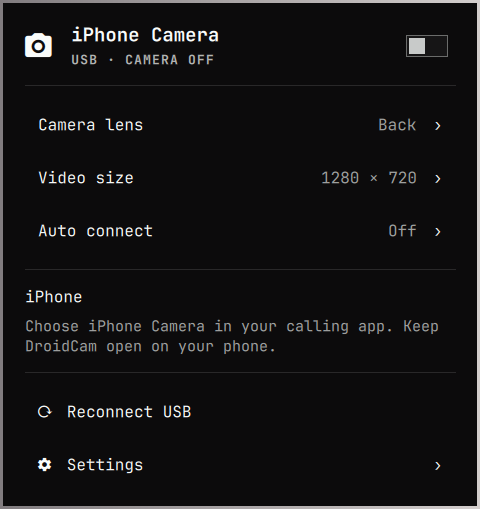

# iPhone Camera

Use your USB-connected iPhone as a webcam from a native Omarchy panel. No OBS or Wi-Fi setup required.

**Two parts, one repository:** the **`iphonecam` Arch package** handles USB video and the virtual webcam; the **`nikshay.iphonecam` Omarchy plugin** provides the upper-right camera toggle, lens selection, video size, and reconnect controls. Install both using the steps below.

## Give this to your AI agent

```text
Install https://github.com/Nikshay1/iphonecam on this Omarchy laptop.
Follow the README's agent quickstart. Reuse an existing checkout or put it
under my ~/Projects folder. Install the Arch package, configure the driver,
enable the native Omarchy panel, and enable login startup. Verify the doctor
JSON, backend status, and shell panel. Keep automatic camera activation off
unless I request it. Help me connect DroidCam on my iPhone, and distinguish
installation checks from a successful live video test. Report any Pro lens
restriction honestly. Leave video off when finished unless I ask otherwise.
```

**Repository access:** this repository is public. Anyone can clone the HTTPS URL below without a GitHub account or token.

## Agent quickstart: install on an Omarchy laptop

Run the following **as the logged-in desktop user, in that user's Omarchy session**. Use that user's home directory, not the maintainer's machine-specific path. `makepkg`, the panel installer, and the app must run as the desktop user; package/driver installation uses sudo where needed.

### 1. Check the desktop and get the source

```bash
command -v omarchy
command -v omarchy-shell
omarchy-shell shell ping
```

The native panel uses Omarchy's Quickshell UI kit and was tested on **Omarchy 4.5.0**. An older Waybar-based installation cannot load this panel. If the shell is unavailable, report that limitation; the package can still provide a standard tray menu on a compatible desktop.

Check for an existing `~/Projects/iphonecam` checkout first. If one exists, inspect `git status` and its remote, then reuse it without overwriting local work. Otherwise:

```bash
mkdir -p "$HOME/Projects"
git clone https://github.com/Nikshay1/iphonecam.git "$HOME/Projects/iphonecam"
cd "$HOME/Projects/iphonecam"
```

The public HTTPS clone does not require authentication. If cloning fails, check the URL and network/proxy configuration. Do not clone into a root-owned directory.

### 2. Install build/runtime prerequisites and matching kernel headers

These commands install packages. Run them in a terminal that can handle sudo prompts. An agent without an interactive terminal should use its secure credential-entry mechanism for sudo; never request a password in chat. **Do not run the whole source build as root.**

Check headers for the kernel that is actually running:

```bash
kernel_release=$(uname -r)
if [[ ! -d "/usr/lib/modules/$kernel_release/build" ]]; then
  kernel_package=$(cat "/usr/lib/modules/$kernel_release/pkgbase")
  omarchy pkg add "${kernel_package}-headers"
fi

test -d "/usr/lib/modules/$kernel_release/build"
```

On the standard Omarchy kernel, the headers package is `linux-omarchy-headers`; other kernels use their matching package. If the last check fails, stop here: the repository's headers may be newer than the running kernel. Explain the mismatch and arrange a kernel update/reboot with the user before continuing. Do not reboot automatically.

Install dependencies **before** `bin/install`, because it builds the app before invoking `makepkg`:

```bash
omarchy pkg add base-devel git qt6-base qt6-declarative qt6-wayland qt6-svg \
  ffmpeg libimobiledevice libusbmuxd usbmuxd v4l2loopback-dkms v4l-utils \
  python glib2 jq
```

### 3. Install the package, driver, and native panel

From the checkout root:

```bash
bin/install --noconfirm
iphonecam setup
bin/enable-panel
bin/enable-autostart
```

| Step | What it does | Success means |
| --- | --- | --- |
| `bin/install` | Builds/tests C++, then installs the Arch package with `makepkg` | `pacman -Q iphonecam` succeeds |
| `iphonecam setup` | Configures boot-time loopback loading and the dedicated camera | `iphonecam doctor --json` reports `"ok": true` |
| `bin/enable-panel` | Copies/enables the native shell plugin before the tray and hides the duplicate tray icon | `omarchy-shell iphonecam open` opens the panel |
| `bin/enable-autostart` | Adds desktop-user login startup | `~/.config/autostart/iphonecam.desktop` exists |

The driver setup reserves **`/dev/video42`**, named **iPhone Camera**. It refuses an occupied camera node or an already-loaded loopback module belonging to another application. Resolve that conflict instead of unloading another app's camera or substituting `/dev/video0`.

The panel installer backs up existing plugin/config files. It changes the user's Omarchy configuration, never `/usr/share/omarchy`. It expects the normal `omarchy.tray` widget; see troubleshooting for a customized layout.

### 4. Start the backend without blocking the agent's terminal

Enabling the panel normally starts the backend through its state observer. If it is not already running, launch it as a transient user service:

```bash
if ! iphonecam status >/dev/null 2>&1; then
  systemd-run --user --collect --unit=iphonecam \
    --property=Restart=on-failure /usr/bin/iphonecam --tray
fi
```

Allow a few seconds for startup, then verify:

```bash
pacman -Q iphonecam
iphonecam doctor --json | jq -e '.ok == true and .virtualCamera == true'
iphonecam status | jq '{status, connected, enabled, streaming, autoConnect, message}'
omarchy-shell iphonecam open
```

**Installation is complete** when the package is installed, `doctor` passes, the backend answers, and the native panel opens. A phone is not required for these checks. With a fresh configuration, `enabled`, `streaming`, and `autoConnect` should be `false`. `connected: false` is expected until an iPhone is connected; it is not a failed installation. Existing user preferences should be preserved.

`iphonecam --tray` and `iphonecam watch` are long-running processes. Do not run either as an unbounded foreground verification command. `watch` streams JSON events; `status` is the one-shot health/state query. Multiple app launches reuse the existing instance.

## Connect the iPhone and use the camera

These steps happen on the phone and cannot be completed by a laptop-only installer:

1. Install/open [DroidCam on the iPhone](https://droidcam.app/obs/) and allow camera access.
2. Connect a **USB data cable** directly to the laptop, unlock the phone, and accept **Trust This Computer** if prompted.
3. Keep DroidCam in the foreground. The Omarchy panel should report a USB connection.
4. Turn on the header toggle in the camera panel.
5. In Meet, Zoom, or your other calling app, select **iPhone Camera**. Keep your laptop/headset microphone selected if that is what you normally use.

Linux has no default-webcam preference that every application follows. Select **iPhone Camera** once in each calling app; this installer does not alter meetings or browser permissions.

**Front/back selection:** open **Camera lens** in the panel. Use the lenses reported by the phone, never a guessed camera ID. **DroidCam Pro may be required for remote lens selection.** If `lensControls` is `false`, inspect `message`; a Pro restriction is not a USB/video failure. You can select the lens on the phone. HD availability and watermarks are also controlled by DroidCam.

**Auto connect** is optional and off by default. Enabling it authorizes video startup whenever a USB iPhone with DroidCam is discovered, including after reconnecting. Starting the tray app at login does not enable this setting.

### Verify real video separately

Once the phone is ready and video is intentionally turned on:

```bash
iphonecam status | jq '{connected, enabled, streaming, lensControls, message}'
timeout 15 ffmpeg -hide_banner -loglevel error -f v4l2 \
  -i /dev/video42 -frames:v 3 -f null -
```

Wait for `streaming: true` before opening the V4L2 consumer. The FFmpeg command reads three frames without recording them; a zero exit status demonstrates that another application can consume the virtual camera. `enabled: true` alone only means video was requested.

Finish a test with:

```bash
iphonecam stop
iphonecam status | jq -e '.enabled == false and .streaming == false'
```

Report precisely what passed: installation, USB discovery, video output, and/or a real conferencing call. A successful build, a demo, or a mock HTTP response is not proof of live iPhone video or physical lens switching.

## Agent controls and automation

| Command | Behavior |
| --- | --- |
| `iphonecam doctor --json` | One-shot dependency/camera identity check; exits 0 on success, 1 on failure |
| `iphonecam status` | One-shot JSON snapshot; exits 1 if the backend is not running |
| `iphonecam watch` | Persistent JSON event stream; starts the backend if absent |
| `iphonecam toggle` | Toggles the requested video state; **not idempotent**, so read status first |
| `iphonecam stop` | Stops transmission; safe to repeat |
| `iphonecam open` | Opens the optional standalone settings window |
| `iphonecam quit` | Stops video and exits the backend |
| `omarchy-shell iphonecam open` / `close` | Opens/closes the native Omarchy panel |

The native panel follows D-Bus events instead of polling. For resolution, lens, or connection preferences, this Bash helper calls the same backend API:

```bash
camera_call() {
  local method="$1"
  shift
  gdbus call --session --dest io.github.Nikshay1.iphonecam \
    --object-path /App --method "io.github.Nikshay1.iphonecam.$method" "$@"
}

camera_call SetResolution 1280x720
```

| Method | Argument | Effect |
| --- | --- | --- |
| `SetResolution` | `640x480`, `1280x720`, or `1920x1080` | Sets the output size; restarts an active stream |
| `SwitchCamera` | Integer ID from `iphonecam status` → `cameras` | Selects a lens when `lensControls` permits it |
| `SetAutoConnect` | `true` or `false` | Sets the user's automatic-activation preference |
| `Reconnect` | None | Reconnects the USB tunnel |
| `Stop` | None | Stops video |

For example, `camera_call SetAutoConnect false` disables automatic activation. Do not enable it unless that is the user's preference. Inspect `iphonecam status | jq '{cameras, activeCamera, lensControls, message}'` before a lens change. The session service/interface is `io.github.Nikshay1.iphonecam`, object `/App`; `StateChanged(string)` carries JSON snapshots.

## Troubleshooting

| Symptom | Check and next action |
| --- | --- |
| Clone returns 404/authentication error | Use the public HTTPS URL above; check its spelling, network access, and any Git URL rewrites or proxy settings. No GitHub token is required. |
| `qmake6` or Qt headers are missing | Install the prerequisites from step 2, then rerun `bin/install`. |
| Missing running-kernel headers | Compare `uname -r` with `/usr/lib/modules/*/build`; install matching headers. A newer installed kernel may need a user-arranged reboot. |
| `doctor` says the virtual camera is missing | Run `iphonecam setup`; inspect its error instead of substituting a physical camera. |
| `/dev/video42` is occupied or loopback is already loaded | Preserve the other camera/app and resolve its configuration first. Do not force-unload its module. |
| `iphonecam status` says not running | Start the backend using step 4. Run in the desktop user's session, with its session D-Bus available. |
| No iPhone in `lsusb` | Try another data cable or direct USB port; keep the phone unlocked. Software cannot fix a charging-only connection. |
| USB sees the phone but the app does not | Check `idevice_id -l` and `systemctl status usbmuxd`; accept Trust and open DroidCam. Restart the service only if its state requires it. |
| Panel missing or `unknown` IPC target | Run `bin/enable-panel` again; allow the shell to reload. Check `omarchy plugin list --json` and `omarchy plugin validate omarchy-plugin`. |
| Custom bar has no `omarchy.tray` anchor | After the plugin has been copied/rescanned, use `omarchy plugin enable nikshay.iphonecam --section right` to place it without that anchor. |
| Front/back buttons are unavailable | Turn video on and inspect `lensControls`/`message`. Pro-denied remote controls do not require reinstalling the desktop app. |
| Camera consumer says “Not a video capture device” | Wait for `streaming: true`. With exclusive capabilities, capture becomes available after the producer starts. |
| Calling app keeps the old video size | Reopen its camera selector after changing resolution. |

Device IDs from `idevice_id -l` and device names can be personal; omit them from public bug reports. If you used the transient service above, `journalctl --user -u iphonecam --no-pager -n 50` shows backend logs. Opening the panel starts an observer that can launch the backend, so close/disable the panel before troubleshooting a deliberate backend shutdown.

## Update an existing installation

From a clean existing checkout, run `git pull --ff-only`. Preserve unrelated local changes. Stop the old backend with `iphonecam quit` if it is running, then repeat **steps 3 and 4**. The plugin is a copied deployment, so **rerun `bin/enable-panel` after panel updates**; pulling Git alone does not update the active shell plugin. Existing preferences, including auto connect, remain in place. Driver setup need not be repeated for a documentation-only update.

## Keyboard controls

| Interface | Keys |
| --- | --- |
| Native panel | j/k or Up/Down to move; Enter/Space to activate; Left to return; Escape to close; Tab for neighboring panels |
| Bar camera icon | Click to open; middle-click to toggle video |
| Standalone window | Space to toggle; Escape to hide; Q to quit; ? for shortcut help |

Closing the standalone window leaves the backend running. **Off** stops desktop transmission; it does not close DroidCam on the phone or revoke its camera permission.

## Development and verification

```bash
bin/build
bin/test
node tests/panel_model.test.js
dbus-run-session -- python tests/dbus_smoke.py
omarchy plugin validate omarchy-plugin
build/iphonecam --demo
```

The optional model test needs `nodejs`. The demo uses fictional device data, opens no USB tunnel/camera, and does not persist preferences. `build/iphonecam --demo --screenshot /absolute/path.png` exports a demo window image; add `--danish` to check Danish without changing the desktop language. English and Danish catalogs are included.

**Hardware tested:** USB video at 1280×720 / 30 fps, a separate V4L2 consumer, off control, and recovery after an interrupted USB tunnel. The tested phone returned a Pro restriction for remote lens control; physical lens switching is not yet hardware verified. See [protocol and verification notes](docs/PROTOCOL.md). [AGENTS.md](AGENTS.md) covers maintainer development work; ordinary installation does not require editing source or pushing commits.

## Launch video and X posts

The [launch kit](marketing/README.md) includes the cinematic video renderer, generated hardware artwork, original score source, captions, and [ready-to-use X post drafts](marketing/X-POSTS.md). Rendered MP4/PNG exports are kept in `build/launch/` rather than committed.

## Privacy and implementation

Video travels from DroidCam through an `iproxy` listener bound to **127.0.0.1**, into FFmpeg, then into the driver-checked `/dev/video42` output. No recording, telemetry, or cloud video service is implemented. Control requests disable proxies, reject redirects, bound response sizes, and expire after 2.5 seconds. Responses from old USB sessions are discarded.

The backend checks attached USB IDs every three seconds and retries interrupted video while enabled. A 1.5-second loopback timeout replaces stalled output with a blank frame; calling apps may retain their own cached image. The fallback tray uses StatusNotifierItem/D-BusMenu; the primary panel uses Omarchy's actual `qs.Ui` components and inherits shell styling.

## Uninstall

Disable the observer panel before quitting, so it cannot start another backend during removal:

```bash
omarchy plugin disable nikshay.iphonecam
iphonecam quit
rm -f "$HOME/.config/autostart/iphonecam.desktop"
sudo pacman -R iphonecam
```

If the backend is already stopped, skip `iphonecam quit`. Remove `~/.config/omarchy/plugins/nikshay.iphonecam` to delete the copied panel. Unhide the fallback `iphonecam` tray icon through Omarchy's tray manager if retaining the package without the native panel.

To remove this project's boot configuration, remove `/etc/modprobe.d/iphonecam.conf`, `/etc/modules-load.d/iphonecam.conf`, and `/etc/udev/rules.d/80-iphonecam.rules`, then reboot after closing camera consumers. Dependencies are not automatically removed. User preferences remain in `~/.config/iphonecam/iphonecam.conf`.

MIT licensed. Theme/language support adapts Omarchy application templates by David Heinemeier Hansson. DroidCam is a separate phone app; it is not bundled. Its HTTP endpoints were researched from vendor documentation and [oma-cam's integration](https://github.com/saurasanchezpablo/oma-cam); no source from that project is bundled.
