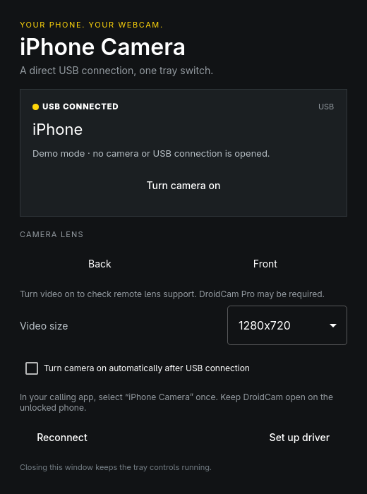

# iPhone Camera

A small native Omarchy app that puts your USB-connected iPhone webcam in the system tray. Turn video on or off, choose a lens, and keep OBS out of the loop.

**Status: first release, hardware validation pending.** Builds and automated tests cover the desktop UI, USB identification, HTTP controls, Pro restrictions, and D-Bus tray protocol. A real iPhone/DroidCam stream must still be verified. Do not read a successful build as a claim that every iOS/DroidCam version is supported.

## What you get

- A top-right tray menu with camera on/off, the lenses reported by DroidCam, reconnect, and settings.
- USB-only device discovery and forwarding through `usbmuxd`/`iproxy`. No Wi-Fi address, OBS, account, or cloud video service.
- A dedicated **iPhone Camera** virtual webcam at `/dev/video42` for Meet, Zoom, OBS, and other V4L2 consumers.
- Resolution selection, optional automatic activation after USB connection, multi-iPhone selection, and reconnect after interrupted streams.
- A Qt Quick window that follows Omarchy's accent, window rounding, and language live. English and Danish UI catalogs are included.
- An Arch package, optional login startup, diagnostics, and a small D-Bus API for automation.

## What the iPhone still needs

Install [DroidCam](https://droidcam.app/obs/) on the iPhone, allow camera access, unlock it, accept **Trust This Computer**, and keep DroidCam in the foreground. This project is an independent desktop controller; it does not include or redistribute DroidCam.

**DroidCam Pro may be required for remote front/back selection.** The app requests the actual camera list and active-camera capabilities. It never guesses that camera 0 is front or back. If the phone denies remote controls, streaming still works and the UI explains the restriction. Use the lens selector on the phone in that case. HD availability and watermarks are controlled by DroidCam.

Linux does not have a default-webcam setting that every application follows. Select **iPhone Camera** once in each calling app. This app does not change existing meetings or browser camera permissions.

## Install on Omarchy

```sh
git clone https://github.com/Nikshay1/iphonecam.git
cd iphonecam
bin/install
iphonecam setup
iphonecam
```

`bin/install` builds, tests, and installs an Arch package with `makepkg`. `iphonecam setup` asks for sudo in your terminal, installs the loopback driver, and configures it to load at boot. Matching headers for the **running kernel** must already be installed (`linux-omarchy-headers` on the standard Omarchy kernel).

The setup refuses to take over an occupied `/dev/video42` or unload an existing loopback driver used by another app. It never changes a physical camera. If another app already loaded v4l2loopback, close it and resolve that configuration before running setup again.

Connect the iPhone and open DroidCam. Open the tray menu and choose **Turn camera on**. When frames are actually flowing, the tray icon turns green. Choose **iPhone Camera** in your calling app. Off stops the video producer; it does not close the iPhone app or revoke its camera permission.

### Start at login

```sh
bin/enable-autostart
```

This starts only the tray controller. Video stays off until you turn it on, unless you explicitly enable **Connect automatically**. Turning this setting on authorizes automatic video startup whenever a USB iPhone with DroidCam is discovered, including after reconnecting it.

Omarchy may initially put the icon inside its tray drawer. Right-click the tray manager and pin **iphonecam** to keep it visible in the upper-right bar.

### Build without installation

```sh
bin/build
bin/test
build/iphonecam --demo
build/iphonecam --tray
```

The demo uses fictional device data and opens neither a camera nor a USB tunnel. Its settings do not persist. Use `--demo --screenshot /absolute/path.png` for a reproducible UI image, or add `--danish` to render Danish without changing the desktop language.

## Controls

| Key | Action |
| --- | --- |
| Space | Turn camera on/off |
| Escape | Hide the window to the tray |
| Q | Quit and stop transmission |
| ? | Show shortcuts |

Closing the window leaves the tray app running. **Quit** stops video and exits. Multiple launches reuse the same running instance.

## Diagnostics and automation

```sh
iphonecam doctor --json
iphonecam status
iphonecam toggle
iphonecam stop
iphonecam quit
```

`doctor` verifies dependencies and the dedicated virtual-camera identity. It does not open the phone camera. `status` reports the running app's state as JSON. The session D-Bus service `io.github.Nikshay1.iphonecam`, object `/App`, provides `Show`, `Toggle`, `Stop`, `SwitchCamera(int)`, `Status`, and `Quit` on the interface of the same name.

For USB detection problems, check `idevice_id -l`, unlock the phone, accept Trust, and verify `systemctl status usbmuxd`. Do not share device identifiers when posting logs. If the camera is missing, run `iphonecam setup`. After changing resolution you may need to reopen the camera in a calling app that holds its old format open.

## Privacy and implementation

Video flows from DroidCam on the iPhone, through an `iproxy` listener bound to **127.0.0.1**, into FFmpeg, then into the dedicated V4L2 output. No frame recording, screenshots of live video, telemetry, or background network calls are implemented. HTTP controls disable proxies, reject redirects, cap responses, and expire requests after 2.5 seconds. Old responses are discarded when the USB session changes.

The tray uses StatusNotifierItem and D-BusMenu directly, so it works with Omarchy's QGuiApplication-based Quickshell without needing Qt Widgets. A timer checks attached USB device IDs every three seconds. It probes DroidCam while connecting and retries interrupted video while enabled. The phone can continue showing its local camera preview after desktop transmission is turned off.

The setup enables a 1.5-second loopback timeout to replace stale images with a blank frame. Applications may cache their own last displayed frame; this project cannot erase another application's buffers.

See [protocol and verification notes](docs/PROTOCOL.md) and [development instructions](AGENTS.md).

## Uninstall

```sh
iphonecam quit
rm -f ~/.config/autostart/iphonecam.desktop
sudo pacman -R iphonecam
```

To remove only this project's boot configuration, remove `/etc/modprobe.d/iphonecam.conf`, `/etc/modules-load.d/iphonecam.conf`, and `/etc/udev/rules.d/80-iphonecam.rules`, then reboot after closing camera consumers. Dependencies are not automatically removed. Existing settings stay in `~/.config/iphonecam/iphonecam.conf`.

MIT licensed. Theme and language support adapt the Omarchy app templates by David Heinemeier Hansson. DroidCam's HTTP endpoints were researched from the vendor's documentation and [oma-cam's integration](https://github.com/saurasanchezpablo/oma-cam); no source from that project is bundled.
